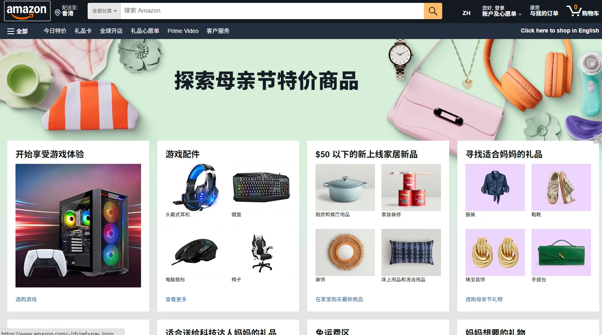
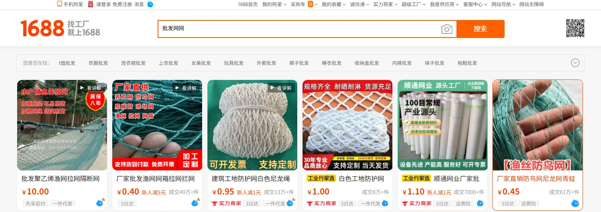
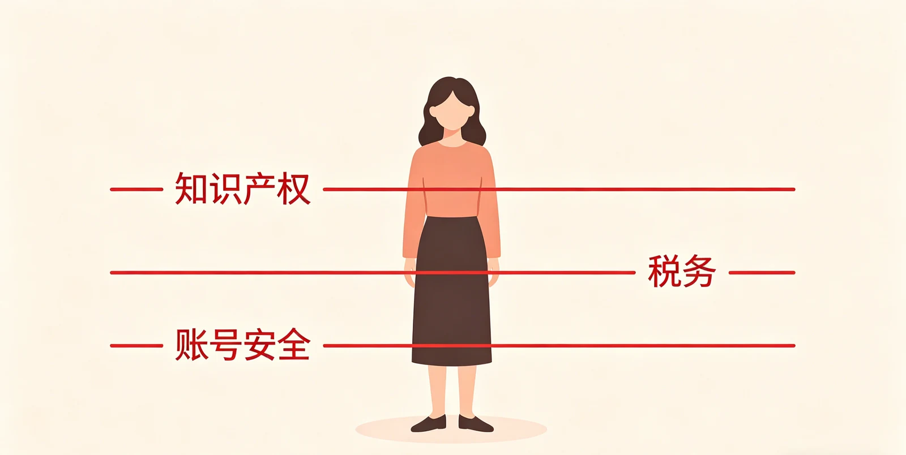
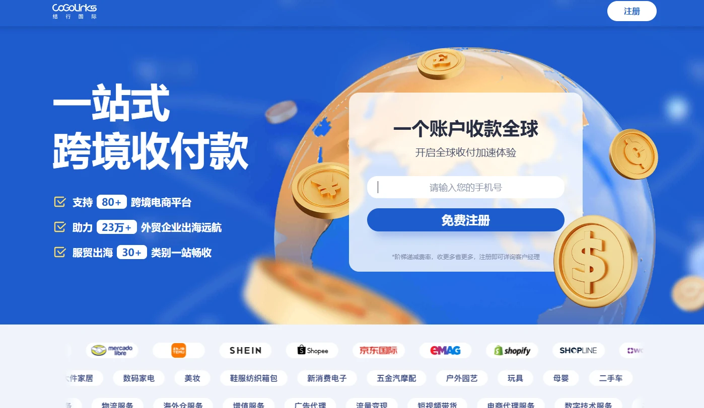

> 学习摘录｜原文：[跨境电商怎么入门？2026 5月零基础完整教程（CSDN）](https://blog.csdn.net/2401_89926894/article/details/160911484)，著作权归原作者所有。原文第四部分为工具推广内容（软文），本摘录略去。

### 摘要

本文面向零基础新手，系统拆解跨境电商从市场调研、平台选择、选品策略到物流支付的全流程。读完你将掌握一套可落地的入门方法论，避开常见的封号、侵权、压货三大坑，直接上手操作。

---

### 一、开篇引入

跨境电商，简单说就是把中国的商品卖到海外去，通过亚马逊、速卖通、Shopee等平台直接触达全球消费者。2026年，**中国跨境电商进出口继续保持两位数增长，东南亚和拉美市场增速超过30%**。

这不是只有大厂才能玩的事情。一个深圳的宝妈靠Shopee卖手机壳，月利润超过3万；一个义乌的大学生做TikTok Shop直播带货，单场GMV突破5万美元。核心逻辑很简单：**中国供应链的优势 + 海外市场的价差 = 利润空间。**

适合什么人做？有货源的小工厂主、想搞副业的上班族、有选品眼光 的个人创业者。核心就一条：能把性价比高的中国产品，精准送到有需求的海外用户手里。

---

### 二、跨境电商入门7步完整教程

#### 第1步：选市场——你的货要卖给谁

不要一上来就盯着美国。2026年最有红利的是三个方向：

- **东南亚（Shopee/Lazada）**：文化相近、物流快、入驻门槛低。适合轻小件、客单价30元以下的家居日用、服饰配件。
- **拉美（Mercado Libre/速卖通）**：增速最快的新兴市场，巴西、墨西哥消费力不低，适合3C配件、美妆工具。
- **欧美（亚马逊/TikTok Shop）**：利润空间最大但竞争最激烈。适合有品牌的差异化产品，客单价20美元以上。

> **新手建议：从东南亚起步。** 物流7天到货，退货率低于3%，试错成本最低。跑通整个流程后再切欧美。

**具体操作**：**打开Google Trends（trends.google.com），输入你的品类关键词 + 国家筛选，看过去12个月的搜索趋势。上升曲线说明需求在增长，可以做；平平或下降说明市场饱和，换方向**。

#### 第2步：选平台——不同平台适合不同人

做了20年外贸的老手和新手选平台逻辑完全不同。给你一张对照表：

|平台|适合人群|入驻门槛|核心优势|佣金|
|---|---|---|---|---|
|Shopee|纯新手、个人卖家|极低，身份证即可|社交裂变流量大|5-6%|
|速卖通|有小团队的新手|低，个体工商户即可|全托管模式省心|5-8%|
|亚马逊|有品牌规划的卖家|高，需营业执照+品牌备案|流量最大、客单价高|15%|
|TikTok Shop|会拍视频的卖家|中|内容引爆速度快|5-8%|
|独立站(Shopify)|有投放预算的进阶玩家|中高|私域流量、利润高|0%+广告费|

> **新手黄金组合：Shopee + TikTok Shop双开。** Shopee吃搜索流量，TikTok吃内容流量，互相导流。

**具体操作**：Shopee注册访问 seller.shopee.cn，准备营业执照和法人身份证照片，3个工作日内审核通过。TikTok Shop注册需要已有的跨境店铺流水截图作为资质证明。

#### 第3步：选品——决定你赚不赚钱的关键一步

选品是跨境电商的灵魂。90%的新手死在选品上。三个铁律：

1. **轻、小、不易碎**：重量500g以内，体积小，国际运费才能压到商品价格的20%以内。
2. **利润率30%以上**：售价 = 进货价 + 运费 + 平台佣金 + 广告费 + 利润。利润低于30%不要碰，一场退货就能让你亏本。
3. **刚需+微创新**：别卖大家都有的通用款。比如手机壳是刚需，但"可拆卸镜头保护手机壳"就是微创新——有差异化才有定价权。

**具体操作——用免费工具选品**：

① 打开亚马逊Best Sellers（amazon.com/Best-Sellers），选你感兴趣的类目，记录Top 100中月销量超过300单的产品特征。  

② 去1688搜同款，看最低拿货价。比如亚马逊上某款瑜伽垫卖 $25，1688同款批发价 ¥18（约 $2.5）。你的毛利空间 = 25 − 2.5 − 5（运费）− 3.75（佣金）= $13.75，利润率55%——这个品可以做。

③ 用Google Trends验证需求是否在上升。搜索"yoga mat"过去5年趋势，如果每年Q1（新年健身季）有明显峰值，说明需求规律性强，可以提前备货。

④ 上架前做竞品评价分析。看同类产品差评集中在哪——“太薄了”、“味道大”、“容易滑”——你的产品如果解决了这些问题，就是直接卖点。

#### 第4步：开店上架——让产品被搜到

注册完账号后，上架不是"传个图写个标题"就完事。搜索排名靠的是Listing优化。

**标题公式**：核心关键词 + 属性词 + 场景词 + 卖点词

错误示范：`漂亮瑜伽垫 加厚 防滑`

正确示范：`Extra Thick Yoga Mat 10mm | Non-Slip Exercise Mat for Home Gym & Pilates | Eco-Friendly TPE Material`

**主图要求**：白底 + 产品占画面80%以上 + 至少6张辅图（尺寸图、细节图、使用场景图、对比图、包装图、认证图）

**定价策略**：新手用"竞品均价×0.85"切入，先积累销量和评价。首月可以不赚钱甚至小亏，目标是把自然排名推上去。

> **重点：每个平台的搜索算法不同。亚马逊看重转化率和评价，Shopee看重销量和聊天响应率，TikTok Shop看重视频完播率和互动率。** 一个品在三个平台需要的运营重心完全不同。

#### 第5步：物流发货——你的货怎么到海外用户手里

三种主流模式，对应不同阶段：

|模式|成本|时效|适合阶段|
|---|---|---|---|
|小包直邮（云途、燕文）|低，¥15-30/票|7-15天|测款期、日均<10单|
|平台官方仓（Shopee SLS/亚马逊FBA）|中|3-7天|数据稳定后|
|第三方海外仓|中高|1-3天|爆款、日均>50单|

**实操流程**：

① 测款期用云途或燕文小包发货。在1688下单后直接在后台填写海外物流单号，货代帮你贴单发出。  
② 跑了50单数据不错后，发一批到平台官方仓（FBA或SLS）。首次备货量 = 日均销量 × 补货周期天数 × 1.5倍安全系数。  
③ 备货前务必确认目标国家的关税起征点：美国$800以下免税，欧盟€22以下免税（2026年起逐步取消，需关注）。超过起征点要预留关税成本。

#### 第6步：引流推广——让用户看到你的产品

有产品没流量等于零。2026年最有效的三种引流方式：

**① 平台内广告**：Shopee关键词广告、亚马逊PPC。新手日预算从 $5-$10 起，重点做长尾词（搜索量低但转化高的精准词），ACOS控制在25%以内。

**② TikTok短视频引流**：拍15-30秒的产品使用场景视频。不需要专业团队，手机拍摄+剪映剪辑就够。核心公式：痛点展示 + 产品解决 + 效果对比 = 转化。挂TikTok Shop链接直接成交。

**③ KOL合作**：找目标市场5000-5万粉丝的小型博主，用"免费寄样 + 销售额10%佣金"置换合作，成本低效果好。一个产品配3-5个KOL做集中曝光。

#### 第7步：客户服务与合规——守住你的店

**客服**：Shopee要求24小时内回复率≥85%，否则降权。用手机装Shopee卖家中心App，设置快捷回复模板，及时响应。

**合规三条红线**：

- **知识产权**：上架前在目标国商标局官网检索关键词是否已被注册。卖"漫威联名手机壳"没有授权？一次投诉直接封店。
- **税务**：欧洲VAT必须注册申报。2026年美国部分州强制征收电商销售税。别抱有侥幸心理。
- **账号安全**：一台电脑一个IP一个账号。多账号操作必须用指纹浏览器（如飞跨浏览器），否则关联封号一夜归零。  
    

---

### 三、实操案例：从0到第一单的全流程演示

以下是一个真实可复制的案例，以**Shopee马来西亚站卖"车载手机支架"**为例：

#### 背景

- 卖家：零基础的上班族，启动资金¥3000
- 平台：Shopee马来西亚站
- 产品：磁吸车载手机支架（重量120g，1688拿货价¥4.8/个）

#### 操作全流程

**第1天——选品验证**

- 在Shopee马来站搜索"phone holder car"，首页前10个商品月销量在200-800之间
- 1688搜同款，¥4.8-6.5区间，选了一家支持一件代发的供应商
- 计算利润：马来站同类产品售价RM15（约¥24），扣掉运费¥8 + 佣金¥1.2 + 拿货价¥4.8 = 毛利¥10/单，利润率41.7%
- 确认可做

**第3天——注册+上架**

- 用个体工商户营业执照注册Shopee账号，2个工作日通过审核
- 上架产品，标题设为：`Magnetic Car Phone Holder 360° Rotation | Strong Suction Mount for All Phones | Dashboard & Windshield`
- 主图用供应商提供的白底图，辅图加了车内安装实拍图
- 定价RM12.99（比均价低约15%），包邮

**第5-7天——出单**

- 第5天自然流量出首单，第6天出2单，第7天出4单
- 用云途小包发货，到马来约8天签收
- 第七天开了关键词广告，日预算RM5（约¥8），选了"phone holder"、“car accessory”、"phone mount"三个精准词

**第14天——数据反馈**

- 累计出单47单，广告费RM70（¥112），总毛利¥470
- 广告ACOS 14.7%，远低于25%的红线
- 收到第一个5星好评：“Fast delivery, strong magnet, good quality”

**第30天——放大**

- 月销破200单，自然排名冲到关键词"phone holder car"的第4名
- 发了一批货到Shopee官方仓（SLS），配送时效从8天缩短到3天
- 联系了2个马来西亚本地小型汽车博主置换推广，粉丝量5000-8000

**结果**：首月总毛利约¥2100，启动资金回收率70%。第二个月日均订单稳定在12-15单，月毛利突破¥5000。

> 这不是虚构数据。车载手机支架是典型的"轻小刚需品"——100多克、运费低、开车的人都需要、损耗快会复购。新手用这种方法选品，成功率远高于凭感觉选。

---

### 五、总结

回顾跨境电商入门的核心要点：

1. **先选市场再选平台**：新手从东南亚Shopee起步，试错成本最低，跑通流程后切欧美
2. **选品是命门**：轻、小、利润率30%以上、刚需+微创新，用亚马逊Best Sellers + 1688 + Google Trends三工具交叉验证
3. **Listing决定流量**：标题堆精准关键词、主图白底占80%、定价用竞品85折切入
4. **物流跟着销量走**：测款用小包直邮，销量稳定后转平台官方仓，爆款上第三方海外仓
5. **合规是底线**：知识产权检索、VAT申报、多账号防关联——三条红线踩中一条就可能一夜归零

跨境电商不是暴富神话，但确实是中国供应链红利下普通人触手可及的机会。选对市场、选对品、坚持三个月以上，数据会给你答案。